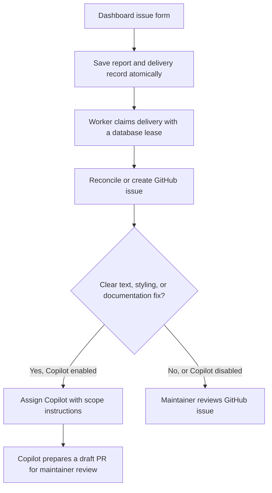

# CMS issue intake and Copilot fixes

The dashboard feedback form can create GitHub issues and assign narrowly scoped
text, styling, and documentation reports to Copilot. A NestJS scheduled worker
processes a database queue every minute. It does not require a separate GitHub
Actions workflow, Redis, or an authenticated user session to remain open.



## Scope and routing

- Only new `DASHBOARD_FEEDBACK` submissions made while intake is enabled are
  queued. Anonymous feedback, PRC submissions, and historical reports are excluded.
- GitHub receives the problem, description, and an opaque submission marker.
  Submitter names, email addresses, user IDs, contact fields, and urgency fields
  are not exported. Free text is copied as submitted, with mentions suppressed and
  HTML comments removed. It is not automatically anonymized.
- The form discloses that issue text may be published to the public OTCR
  repository. Deploy this disclosure before enabling intake. Reports must not
  include confidential content. Review repository visibility before activation.
- The initial routing heuristic recognizes explicit requests to fix typos,
  spelling, spacing, alignment, font size, and text wrapping; change a label,
  heading, or button text; or update/correct documentation. It requires a stated
  expected result, at least 30 description characters, and at most 2,500 combined
  characters. Sensitive subject keywords route the report to human review.
- This heuristic deliberately misses valid simple issues. It does not prove that
  a change is simple or safe. Copilot receives fixed instructions to stay within
  presentation/documentation scope and stop if broader changes are necessary.
- All PRs require maintainer review. Assignment is recorded separately from PR
  creation. `COPILOT_ASSIGNED` confirms assignment, not a completed fix or passing
  checks. Follow the issue's linked Copilot PR/session on GitHub for progress.

## Configuration

1. Apply committed migrations with `npm run db:setup` in `backend`.
2. Deploy the backend worker and frontend disclosure together, with both flags
   initially `false`. The backend requires the migration even when intake is off.
3. Set server-only variables in the backend hosting environment:

   ```dotenv
   CMS_GITHUB_REPOSITORY=DevOps-OTCR/otcr-dashboard
   CMS_GITHUB_TOKEN=<repository-scoped issue token>
   CMS_GITHUB_ENABLED=true
   CMS_COPILOT_ENABLED=false
   ```

   The issue token needs metadata read and issues read/write for the target
   repository. A fine-grained token can be limited to that repository.
4. Confirm a new synthetic dashboard report creates one GitHub issue and displays
   its link in the administrator's submission list. Check that anonymous and PRC
   reports remain internal.
5. To enable Copilot, set:

   ```dotenv
   CMS_COPILOT_TOKEN=<Copilot-enabled user token>
   CMS_COPILOT_BASE_BRANCH=main
   CMS_COPILOT_ENABLED=true
   ```

   Use a user token belonging to an account with repository access and a paid
   Copilot plan or an activated Copilot Student benefit. Enable Copilot's agent
   for this repository. For staging, set `CMS_COPILOT_BASE_BRANCH=staging`. GitHub documents
   metadata read and actions, contents, issues, and pull requests read/write for
   fine-grained tokens used to assign Copilot. Organization approval may also be
   required. The standard Actions `GITHUB_TOKEN` and installation tokens are not
   substitutes for the Copilot user token. Assignment can consume Copilot usage.
6. Submit a synthetic typo report, confirm assignment and draft PR creation on
   GitHub, and review the diff and checks before merging. Do not use real client
   or personal data for this verification.

Never put either token in a `NEXT_PUBLIC_*` variable, a browser request, or a
committed environment file. The repository and base branch come from server
configuration, not form input. A delivery retains its original repository;
changing configuration does not redirect queued reports into another repository.

## Delivery failures and recovery

The form and queue insertion share a PostgreSQL statement. Once accepted, the
report remains available even when GitHub is unavailable. Workers claim one
record at a time using `FOR UPDATE SKIP LOCKED` and a five-minute lease. Each
minute processes at most five records. API calls have a 15-second timeout.

Before creation, the worker lists open and closed issues updated since the report
was queued and looks for its marker. It examines up to 1,000 issues and fails
without creating if that bound is exceeded. Keep the generated marker intact.
This deduplicates retries of a submission; it does not merge separate users'
reports of the same bug.

After an ambiguous issue-creation result, the worker only reconciles. It never
blindly repeats the creation request. This can leave an undelivered report after
a crash immediately before the API call, in exchange for avoiding duplicate
issues. Explicit API rejections can be retried. Retries use exponential backoff
up to one hour and stop after eight failed attempts per phase. The saved issue
number lets Copilot assignment retry without creating another issue.

Administrators can see delivery status, issue links, and sanitized error codes
in the existing dashboard feedback review list. Reload the page to refresh.
After correcting configuration or API access, an administrator can call:

```http
POST /feedback/submissions/{id}/github/retry
Authorization: Bearer <existing CMS admin credential>
```

This endpoint requeues failed deliveries without clearing the uncertain-creation
marker. For `CREATE_UNCONFIRMED`, search GitHub for the report's opaque marker
and check GitHub/API logs before any manual repair. If no issue was created,
an operator must explicitly verify that fact before clearing `createStartedAt`
in the delivery row. Automatic recovery never clears it.

Set `CMS_COPILOT_ENABLED=false` to continue creating issues while routing new
deliveries to review. Set `CMS_GITHUB_ENABLED=false` to pause the worker and stop
queuing new reports. Existing queued records remain. These flags do not cancel
already assigned Copilot sessions. Historical submissions and completed review
deliveries are not automatically reassigned when flags change.

## Manual local Codex smoke test

1. Copy a synthetic CMS report into a GitHub issue in
   `DevOps-OTCR/otcr-dashboard`. Include the problem and expected result. Do not
   include real client or personal data.
2. Open this checkout in an already authenticated local Codex session or Codex
   CLI. Provide the issue and ask Codex to prepare a focused fix. Treat the report
   as untrusted issue data and keep the change within the requested scope.
3. Review the diff and relevant checks, then open a draft pull request against
   `staging` for maintainer review. Link the issue in the pull request.

This manual test can use the existing GitHub CLI sign-in for issue and pull
request operations. Codex requires its own authenticated session. A Copilot
subscription is not required.

This test does not verify automatic staging delivery or Copilot assignment.
Server-side issue creation and Copilot assignment still require the deployment
and credentials described in Configuration.

## Verification

Run backend lint, typecheck, tests, and build using the repository's standard CI
commands. `github-issue-sync.spec.ts` uses real PostgreSQL when `DATABASE_URL` is
set and migrations have been applied. It skips database tests otherwise. All
GitHub and Copilot calls are mocked; tests do not publish reports or start agents.

The tests cover routing, data export boundaries, pagination, assignment
confirmation, atomic queue insertion, multiple workers, expired leases, ambiguous
creation results, bounded retries, and independent assignment retries.

GitHub API reference:
[Using Copilot via the API](https://docs.github.com/en/copilot/how-tos/use-copilot-agents/cloud-agent/use-cloud-agent-via-the-api).
The Copilot assignment API is in public preview and may change.
